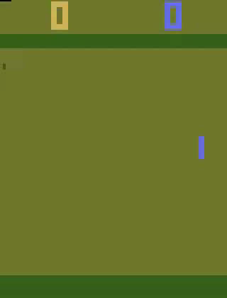

# Atari Pong — Advantage Actor-Critic (A2C) Agent

A reinforcement learning agent that learns to play Atari **Pong** using
**Advantage Actor-Critic (A2C)** with **N-step returns**, implemented in
PyTorch on top of the Gymnasium / Arcade Learning Environment (ALE).



*The agent (green paddle, right) returning the ball during an evaluation episode.*

## What the agent does

The agent controls the right paddle and learns a policy that moves it **up** or
**down** to hit the ball past the opponent. It receives `+1` for scoring and
`-1` for conceding, and learns purely from this reward signal.

Rather than learning from raw pixels, the environment exposes a compact
**6-dimensional state** derived from the emulator RAM and the last two frames:

| Feature | Meaning |
|---|---|
| `player_y` | Agent paddle vertical position |
| `enemy_y` | Opponent paddle vertical position |
| `ball_x`, `ball_y` | Ball position |
| `ball_dx`, `ball_dy` | Ball velocity (difference across the 2-frame stack) |

Features are normalized to roughly zero mean and unit variance before being fed
to the networks. The action space is restricted to two actions (up / down) to
make learning easier.

## How it works

A2C trains two networks together:

- **Actor (policy network)** — maps a state to action logits; the agent samples
  its move from the resulting softmax distribution.
- **Critic (value network)** — estimates the expected return `V(s)` from a
  state, used as a baseline to reduce the variance of the policy gradient.

Both are 2-hidden-layer MLPs (256 units, ReLU) trained with Adam.

**Learning signal.** For each trajectory the agent computes **N-step returns**:

```
G_t = r_t + γ·r_{t+1} + γ²·r_{t+2} + ... + γ^{n-1}·r_{t+n-1} + γ^n·V(s_{t+n})
```

with `n = 10` and discount `γ = 0.98`. The N-step return is computed in a
vectorized way using cumulative sums, padding, and a precomputed discount
vector, with bootstrapping zeroed out at terminal states.

- **Critic loss:** MSE between `V(s_t)` and the (detached) N-step return.
- **Actor loss:** policy gradient weighted by the **advantage**
  `A_t = G_t − V(s_t)`, i.e. `−A_t · log π(a_t | s_t)`.

Gradients are accumulated over a small batch of episodes (default 4) before each
optimizer step.

## Results

Training reward climbs as the policy improves over episodes, and evaluation
reward (averaged over held-out episodes) tracks the same trend.

| Training reward | Evaluation reward |
|---|---|
|  |  |

A trained checkpoint is included at [`checkpoint.pth`](checkpoint.pth).

## Repository layout

```
agent.py          A2C agent: Policy, Value, N-step returns, losses, training loop
environment.py    Pong environment wrapper (Gymnasium / ALE, RAM-based state)
utils.py          Argument parsing, seeding, reward plotting
environment.yml   Conda environment specification
checkpoint.pth    Trained policy + value network weights
assets/           Demo clip and reward plots
```

## Running it


**Train** from scratch (writes `checkpoint.pth` and reward plots):

```bash
python agent.py
```

Useful flags (see `utils.py` for the full list and defaults):

| Flag | Default | Meaning |
|---|---|---|
| `--train-episodes` | 30000 | Total training episodes |
| `--gamma` | 0.98 | Discount factor |
| `--lr` | 0.0003 | Learning rate |
| `--batch-size` | 4 | Episodes per gradient update |
| `--max-steps` | 300 | Max steps per episode |
| `--eval-every` | 500 | Episodes between evaluations |

**Evaluate** a trained agent and record gameplay videos to `outputs/`:

```bash
python agent.py --eval-only
```

## Notes

The state is engineered from emulator RAM (not learned from pixels), which keeps
the networks small and training fast while still requiring the agent to learn
ball tracking and interception from reward alone.
